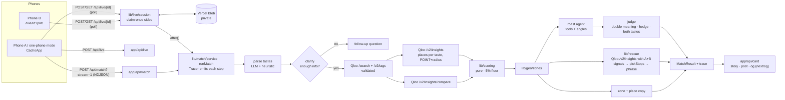

# 🦌 Cacho-Map

**What's your cheating risk?** Two people type what they like (artists, movies, shows, books, food). Cacho-Map uses the **Qloo Taste AI** to find each person's favorite places in their own city and measures the **"riesgo de cacho" (cheating risk)**: how many of the plans one likes, the other doesn't. That's where one ends up going out alone... or with other company. It maps the *danger zones* and *safe zones*, and an AI agent roasts them with light cheating wordplay in Spanish or English.

Live: **https://cacho-map.vercel.app** · Built for the Qloo Agentic Hackathon (2026).

> "Cachos" is Colombian slang for horns, i.e. being cheated on ("le montaron los cachos"). The app's joke: if your plans don't overlap, you go out separately, and that's where "cacho" risk lives. It only ever measures plans, never real infidelity. Consent-based, nicknames only.

## Features

### New in v9

- **Live couple mode (two phones).** Person A opens a room and gets a link + QR code (WhatsApp share, copy). Each person types their own tastes on their own phone; neither sees the other's until both are in. Then both phones show the agent working and reveal the same result (polling `GET /api/live/[id]`; state in a private Vercel Blob store, compute runs with `after()`). The original one-phone mode is still the default tab.
- **Rescue plan.** 2–3 real Qloo places near you that work for **both** people, as a short route (km per leg, numbered pins and a dashed line on the map). Each stop says which taste of each person it satisfies ("For Jesús: horror movies · For Karol: K-dramas"). Places come from two extra `/v2/insights` calls with both people's signals combined; the picker prefers stops that serve both, then alternates one per person. A small model only phrases "what to do there" from the place's own Qloo types and cuisines; every line is checked (language, length, no invented people/tastes) with a template fallback.
- **Visible agent.** The pipeline streams its reasoning live (NDJSON): parse → *is there enough info?* → Qloo search → places → compare → score → zones → roast/judge → rescue, each step with the Qloo endpoint it called, timing and a one-line finding ("12 Qloo calls: 30 places for Jesús, 30 for Karol").
- **The agent asks before guessing.** If one person's input is too thin (fewer than 2 tastes, or only food/outings, or only media with no places), the agent stops and asks a short follow-up with one-tap ideas (including the other person's tastes), then continues. It asks each person at most once; "keep going" skips it.
- **Shareable cards.** `next/og` images for Instagram story (1080×1920), feed (1080×1350) and X/link previews (1200×630) with the %, the level, the best joke and a doodle map of the danger/safe zones. Share-image (Web Share API with files) and download buttons; `/r` and `/live/[id]` links carry proper OG/Twitter meta so the card shows up in WhatsApp/X.
- **Stricter joke judge.** The judge must name the double meaning ("rolling = sushi roll / leaving"), confirm the pun is real in that language, and flag hedged punchlines ("…or maybe he's just…"); jokes that use both people's tastes rank higher, and different joke angles are rotated. Unfinished, hedged or unjudged jokes fall back to the safe template.

### Core

- **Works anywhere.** Uses the browser's location (reverse-geocoded with BigDataCloud's free client API) or a city picker; Cartagena is the default.
- **Qloo at the core.** Entity search, taste comparison and location-aware place recommendations drive the score, the map and every joke.
- **Zones for any city.** Neighborhoods come from Qloo place data, with nearest-neighbor and compass fallbacks (and a hand-made refinement for Cartagena).
- **Tool-calling roast agent** (AI SDK + Vercel AI Gateway) grounded in the Qloo data, with a humor guide based on research of what couple humor actually travels on X ([docs/humor.md](docs/humor.md)).
- **Cheating-risk meter** with levels (bajo / medio / alto / "ya hay cacho") and a "how is it calculated" breakdown with the real counts.
- **Danger zones vs. safe zones.** Each zone card is characterized from Qloo place data (dominant place types, cuisines, ambience tags, price) and says why it's risky or safe for this couple. A cheap LLM only *phrases* those facts (strict "use only the given facts" prompt); a deterministic template is the fallback.
- **Explainable places and zones.** Every place records which of each person's tastes brought it (the blend keeps per-taste contributions). Popups say "Por esto: le sale a Jesús por su gusto por el anime"; zone cards say "Getsemaní: bares y cafés. Aquí le salen planes por los gustos de Karol (vallenato, BTS) y casi nada por los de Jesús (acción, anime) → Karol iría sin Jesús"; the % sentence and the "how is it calculated" panel break it down per taste.
- **Live map.** OpenFreeMap vector tiles recolored to the app palette, animated pins, a heat layer showing the cheating risk per neighborhood, fly-to animations.
- **ES / EN** across UI and AI output, saved in `localStorage`, defaulting to the browser language. Switching language with a result on screen regenerates it (AI copy is written in one language); every AI line passes a language guard with a template fallback, and a test checks both dictionaries have the same keys and read as the right language.
- WhatsApp share and short `/r` result links.

## Architecture



```
app/                 routes: page, /api/match (JSON or NDJSON stream), /api/live, /api/live/[id],
                     /api/card (story/post/og), /r share page, /live/[id] room
components/          CachoApp, MatchForm, ResultView, AgentTrace, FollowUpCard, RescuePlan,
                     ShareCard, LiveStart, LiveSession, QrCode, ZoneList, LocationPicker…
  map/               CachoMap (MapLibre: pins, heat, rescue route) + mapTheme
  reactbits/         Animated components from React Bits (vendored verbatim)
lib/
  qloo/              HTTP client (retry, cache) and typed API helpers (incl. placesForBoth)
  geo/               preset cities, distance, zone assignment, browser geolocation
  scoring/           pure scoring functions + vitest tests
  agent/             prompt, tools, roast + judge, clarify (follow-up policy), trace, sanitizer
  rescue/            pick (pure: scoring, route), phrase (checked LLM lines), buildRescue
  live/              session state machine + JsonStore (Vercel Blob / memory)
  card/              card params (encode/parse) + Satori layout
  match/             request schemas (zod), runMatch orchestrator, NDJSON client
  i18n/              ES/EN dictionaries + LangProvider
docs/humor.md        humor research and the rules the prompt follows
```

## How Qloo is used

1. **Natural text in, atomic tastes out.** Each person writes freely ("Me gusta Lana del Rey, el mentalista, películas de acción y las motos, el gym y ver anime"). One LLM call (`lib/tastes/parse.ts`) splits it into atomic tastes, each with ES/EN labels, a canonical English query, its kind (title / genre / food / activity) and 0–3 **place kinds** a fan would obviously go to (anime → cinemas, video game stores, comic stores; gym → gyms; playa → beaches; fresas con crema → ice cream and dessert shops). A heuristic splitter is the fallback.
2. **`/search`** and **`/v2/tags`**, **validated** (`lib/tastes/match.ts`): Qloo always returns a best guess, so every match is checked against what was meant (word coverage + character-bigram similarity, Qloo alternate titles). "kdramas" → "40k" or "Drama" is rejected, "K-Drama" accepted; "fresas con crema" → "Waffle With Strawberry And Ice Cream" rejected, the "Desserts" cuisine tag accepted. Lifestyle tastes (gym, playa, motos) are understood as place kinds only. Rejected tastes are shown crossed out with the reason ("Qloo only found 40k", "no places for this nearby").
3. **`/v2/insights`** with `filter.type=urn:entity:place`, `filter.location=POINT(lon lat)` and a radius around the user, called **once per taste** (up to 7 per person). When the taste has place kinds, the call adds `filter.tags=urn:tag:genre:place:…` (OR) so Qloo returns places **of those kinds ranked for that taste**; that's what makes every place explainable. (Without it, genre tags like anime or k-drama return the same generic list in Cartagena.) Otherwise it falls back to Qloo's general places for the taste's fans. Each person's favorites are a blend of those lists (`lib/scoring/blend.ts`): rank score × weight, where titles weigh 1, cuisines 0.6 and broad categories 0.3, normalized and **capped at 40% per input**, so one cuisine can't take over. Four unrelated "probe" tastes (The Lion King, Beethoven, MasterChef, The Great Gatsby) give a **popular-for-anyone baseline** per city; places in 3 of 4 probe lists are left out of the comparison. Result: each person's **top 20 places**.
4. **`/v2/insights/compare`**: shared taste tags, shown as a secondary "taste affinity" stat and given to the agent as joke material.
5. Place tags (`genre:place`, `cuisine`, `ambience`, `activity_type`), `short_description` and `price_level` feed the zone profiles and place popups.
6. The agent's tools (`getRisk`, `getSharedTasteTags`, `getZones`, `getPlaces`) expose only this Qloo-derived data, so the roast always cites real tastes and real places.

The compare call and both place calls run in parallel. Qloo calls retry on 429/5xx with exponential backoff and are cached for 24 h. No raw Qloo data is stored in the repo.

## Scoring

```
Tastes are first deduplicated per person (ceviche + mariscos + comida de mar -> one seafood taste;
"salsa" + "bailar salsa" -> one) and paired across the couple (lib/tastes/dedupe.ts): two tastes pair
if they're the same Qloo entity/tag or label, foods with the same place kinds, signal-less activities
with mostly the same place kinds, or a title whose Qloo facts name the other's genre (Making a
Murderer ~ true crime). A signal-less twin ("bailar salsa") takes its partner's Qloo signal.

taste part = 1 − ( 0.85 × mean(paired tastes A / tastes A, paired B / tastes B) + 0.15 × tag affinity )
             (without Qloo signals on both sides: affinity left out)
A = top 20 blended Qloo places for person 1, B = same for person 2 (popular-for-anyone places removed)
a place of A is shared if it's in B's top 30 OR it comes from a taste of A paired with one of B
plan part  = mean( unshared A / |A| , unshared B / |B| )
raw risk   = round( (taste part + plan part) / 2 × 100 )
risk       = max(5, raw risk)      "el 5% es el mínimo: en Cacho-Map nadie está 100% a salvo"
                                   (the % sentence and the panel show the raw number when floored)
level = "pareja blindada" ≤ 10 < bajo < 35 ≤ medio < 60 ≤ alto < 80 ≤ "ya hay cacho"
zone risk = places in the zone only one of them would go to (not shared, as above) / places in the zone
zone kind = danger if zone risk ≥ 50%, else safe (both would go)
tag affinity (secondary) = rescale(mean Qloo tag score, 0.50 → 0, 0.73 → 100) × min(1, tags / 40)
```

The roast may only quote the overall %. For a "pareja blindada" (≤ 10%) the prompt, judge context and fallback template steer to "ni el cacho los separa" / "not even a cacho can split them", citing a taste the two really share. The agent writes 3 candidates using 3 rotating few-shot examples from a curated bank (`lib/agent/examples.ts`, never ones about the couple's own tastes). A judge (`gemini-2.5-flash`, the strongest free-tier model) checks each one for makes-sense, real wordplay, punchline at the end, no contradiction and safety, rates funniness and force-ranks them. Anything failing a criterion or below 3/5 is rejected; if none passes, the agent regenerates once (time permitting).

**Pronouns.** Each person picks él/ella/elle (he/she/they), neutral by default. They go into every prompt (roast, plan, zone and place copy), and `lib/agent/gender.ts` fixes "solo/sola" to the right form ("sin compañía" for neutral) and drops sentences with pronouns nobody uses.

## Run locally

```bash
cp .env.example .env.local   # add QLOO_API_KEY and, locally, AI_GATEWAY_API_KEY
                             # optional: BLOB_READ_WRITE_TOKEN for live rooms (without it they use memory)
npm install                  # also copies the MapLibre worker into public/vendor
npm run dev
npm test                     # vitest (133 tests): scoring, zones, sanitizer, judge, clarify, trace, rescue, cards, live sessions
npm run lint && npm run typecheck
```

On Vercel the AI Gateway authenticates with OIDC. `AI_MODEL` overrides the default model (`google/gemini-2.5-flash`). Without an LLM the app falls back to a template roast.

## Safety

Nicknames only and an explicit consent checkbox. Jokes are light cheating *wordplay* about plans and tastes: never real accusations, explicit content, bodies, sexuality, religion, politics, real third parties, or trashing a business. The output sanitizer enforces the % rule, strips banned phrasing and drops any sentence with dark or violent imagery.

## Credits

- Taste data: [Qloo](https://www.qloo.com).
- Animated UI pieces from **[React Bits](https://reactbits.dev)** by David Haz: `CountUp`, `RotatingText`, `ShinyText`, `TiltedCard`, `ClickSpark` (in `components/reactbits/`).
- Map tiles: [OpenFreeMap](https://openfreemap.org), © [OpenMapTiles](https://www.openmaptiles.org/), data © [OpenStreetMap](https://www.openstreetmap.org/copyright) contributors.
- Reverse geocoding: [BigDataCloud](https://www.bigdatacloud.com) free client API.
- Font: Bricolage Grotesque and JetBrains Mono (SIL Open Font License).

License: MIT.
