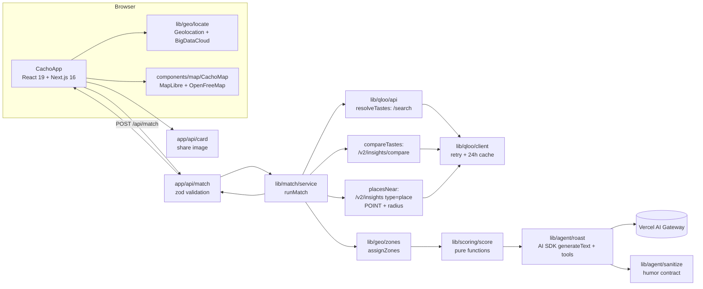

# 🦌 Cacho-Map

**How hard do you cheat on each other's taste?** Two people type what they like (artists, movies, shows, books). Cacho-Map uses the **Qloo Taste AI** to measure how compatible they are, maps *where in their own city* they'd fight over plans, and an AI agent roasts them in Spanish or English.

Live: **https://cacho-map.vercel.app** · Built for the Qloo Agentic Hackathon (2026).

> "Cachos" is Colombian slang for horns (being cheated on). Here it only means *taste-cheating*: picking a different playlist, restaurant or movie. It's a consent-based joke, nicknames only.

## Features

- **Works anywhere.** Uses the browser's location (reverse-geocoded with BigDataCloud's free client API) or a city picker; Cartagena is the default.
- **Qloo at the core.** Entity search, taste comparison and location-aware place recommendations drive the score, the map and every joke.
- **Zones for any city.** Neighborhoods come from Qloo place data, with nearest-neighbor and compass fallbacks (and a hand-made refinement for Cartagena).
- **Tool-calling roast agent** (AI SDK + Vercel AI Gateway) grounded in the Qloo data, with a humor guide based on research of what couple humor actually travels on X ([docs/humor.md](docs/humor.md)).
- **Live map.** OpenFreeMap vector tiles recolored to the app palette, animated pins, a heat layer showing the disagreement per neighborhood, popups with place info, fly-to animations.
- **ES / EN** across UI and AI output, saved in `localStorage`, defaulting to the browser language.
- Shareable 4:5 card (`next/og`) and WhatsApp share.

## Architecture



```
app/                 Next.js routes (page, /api/match, /api/card, /r share page)
components/          UI: CachoApp, MatchForm, ResultView, ZoneList, LocationPicker, LoadingState…
  map/               CachoMap (MapLibre) + mapTheme (basemap, palette, heat stops)
  reactbits/         Animated components from React Bits (vendored verbatim)
lib/
  qloo/              HTTP client (retry, cache) and typed API helpers
  geo/               preset cities, distance, zone assignment, browser geolocation
  scoring/           pure scoring functions + vitest tests
  agent/             prompt, tools, roast generation, output sanitizer, template fallback
  match/             request schema (zod) and the runMatch orchestrator
  i18n/              ES/EN dictionaries + LangProvider
  text/              name normalization (ALL CAPS → Title Case)
docs/humor.md        humor research and the rules the prompt follows
```

## How Qloo is used

1. **`/search`**: each free-text taste ("Bad Bunny", "Amélie") → a Qloo entity, in parallel.
2. **`/v2/insights/compare`**: shared taste tags between the two sets of entities → **60%** of the score.
3. **`/v2/insights`** with `filter.type=urn:entity:place`, `filter.location=POINT(lon lat)` and a radius around the user, personalized with `signal.interests.entities` for each person → their top 25 places. The overlap (Jaccard) is **40%** of the score, and each place's neighborhood feeds the zone breakdown.
4. The agent's tools (`getCompatibility`, `getSharedTasteTags`, `getZoneClashes`, `getPlaces`) expose only this Qloo-derived data, so the roast always cites real tastes and real places.

The compare call and both place calls run in parallel. Qloo calls retry on 429/5xx with exponential backoff and are cached for 24 h. No raw Qloo data is stored in the repo.

## Scoring

```
tagScore   = rescale(mean Qloo tag score, 0.50 → 0, 0.73 → 100) × min(1, tags / 40)
placeScore = |top25(A) ∩ top25(B)| / |top25(A) ∪ top25(B)| × 100
compat     = round(0.6 × tagScore + 0.4 × placeScore)
cachos     = 100 − compat
zone disagreement = places in the zone only one of them would pick / places in the zone
```

The roast may only quote the overall % (zone figures are shown as bars, never as numbers in jokes).

## Run locally

```bash
cp .env.example .env.local   # add QLOO_API_KEY and, locally, AI_GATEWAY_API_KEY
npm install                  # also copies the MapLibre worker into public/vendor
npm run dev
npm test                     # vitest: scoring, zones, sanitizer, name normalization
npm run lint && npm run typecheck
```

On Vercel the AI Gateway authenticates with OIDC. `AI_MODEL` overrides the default model (`google/gemini-2.5-flash`). Without an LLM the app falls back to a template roast.

## Safety

Nicknames only and an explicit consent checkbox. Jokes are about tastes only: never real infidelity, bodies, sexuality, religion, politics, real third parties, or trashing a business. The output sanitizer enforces the % rule and strips banned phrasing.

## Credits

- Taste data: [Qloo](https://www.qloo.com).
- Animated UI pieces from **[React Bits](https://reactbits.dev)** by David Haz: `CountUp`, `RotatingText`, `ShinyText`, `TiltedCard`, `ClickSpark` (in `components/reactbits/`).
- Map tiles: [OpenFreeMap](https://openfreemap.org), © [OpenMapTiles](https://www.openmaptiles.org/), data © [OpenStreetMap](https://www.openstreetmap.org/copyright) contributors.
- Reverse geocoding: [BigDataCloud](https://www.bigdatacloud.com) free client API.
- Font: Bricolage Grotesque and JetBrains Mono (SIL Open Font License).

License: MIT.
